  <picture>
    <source media="(prefers-color-scheme: dark)" srcset="./dark.svg">
    <source media="(prefers-color-scheme: light)" srcset="./light.svg">
    
  </picture>

### About

Computer Science and Engineering undergraduate at **National Institute of Technology Calicut (NITC)** focused on understanding one layer below the abstraction.

- **Systems & Architecture:** Low-level systems internals, memory models, emulation, and computer architecture
- **Algorithms & Data Structures:** Algorithmic problem solving and complexity-driven design
- **Data Systems:** Relational modeling and database fundamentals

---

### Featured Project

#### [`chip8-emulator`](https://github.com/mruna1h/chip8-emulator)
Cycle-accurate CHIP-8 emulator built from first principles in **C++** and **SDL2**, featuring:
- Accurate opcode fetch-decode-execute cycle timing and timer synchronization
- Custom display color themes
- Configurable execution speed controls
- Savestate serialization and restoration

---

### Core Stack

`C` · `C++` · `Python` · `SQL`

---

### Competitive Programming & Profiles

| Platform | Handle / Link |
| :--- | :--- |
| **GitHub** | [github.com/mruna1h](https://github.com/mruna1h) |
| **LeetCode** | [leetcode.com/u/Mruna1](https://leetcode.com/u/Mruna1) |
| **Codeforces** | [codeforces.com/profile/mruna1](https://codeforces.com/profile/mruna1) |