<picture>
  <source media="(prefers-color-scheme: dark)" srcset="./assets/shonen-title-dark.svg">
  
</picture>

<b>mruna1h</b>

#### Character sheet

<picture>
  <source media="(prefers-color-scheme: dark)" srcset="./assets/shonen-sheet-dark.svg">
  
</picture>

How these stats are computed

- **STR** — Contributions, last 12 months: 14
- **AGI** — Active days: 8
- **END** — Longest streak (days): 2
- **INT** — Languages wielded: 0
- **CHA** — Stars earned: 0
- **Rank** — average of the five bars (S ≥ 85%, A ≥ 70%, B ≥ 50%, C ≥ 30%).
- **Power level** — contributions×9 + stars×21 + followers×13 + active days×7 + longest streak×42. Scientifically meaningless. Spiritually accurate.

Artwork: original animated SVG, generated by README Templates · template: Shōnen. Motion stops if your system asks for reduced motion.

<picture>
  <source media="(prefers-color-scheme: dark)" srcset="./assets/shonen-end-dark.svg">
  
</picture>

